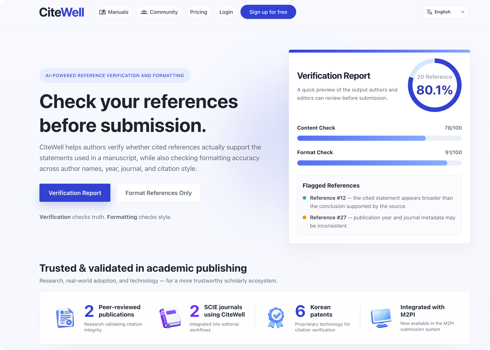
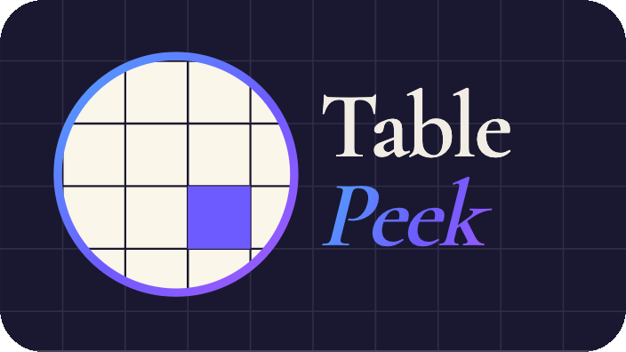
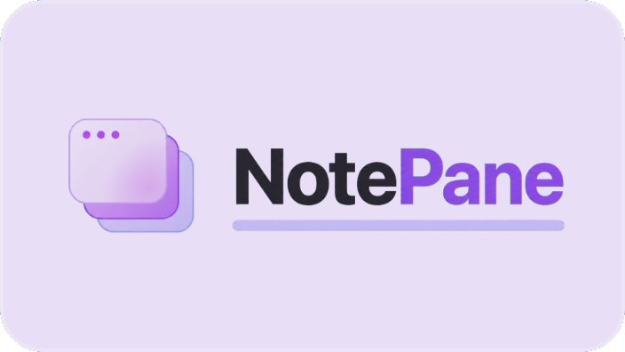

### 💼 Now at Research Factory

<table>
<tr>
<td valign="top">

<h3><a href="https://citewell.org">CiteWell</a></h3>
<b>Check your references before submission.</b> 
AI writing tools make it easy to cite a paper that doesn’t exist, or one that doesn’t say what the sentence claims. CiteWell checks every reference in a manuscript: is it real, does it support the statement, and does it match the journal’s citation style. It is built for medical researchers preparing a submission and for the journal editors who review it.
  
Used by 2 SCIE journals · built into the M2PI submission system
  
<b>My role</b> · Full-stack engineer on the Program Team. I work across the Django REST backend, the Vue frontend, and the engine that verifies and formats references.
  
Django · DRF · Vue · Redis · PostgreSQL · since Dec 2023 
<a href="https://citewell.org">citewell.org →</a> &nbsp;·&nbsp; <a href="https://extransload.github.io/works/citewell/">Folio →</a>
</td>
</tr>
</table>

### 🚀 What I'm building

<table>
<tr>
<td width="50%" valign="top">

<h3><a href="https://github.com/Extransload/TablePeek">TablePeek</a></h3>
A fast database client, as a desktop app or a browser tab. PostgreSQL, MySQL, MongoDB, Redis and more.
  
 &nbsp;Rust · React · macOS · Windows
  
<code>brew install --cask extransload/tap/tablepeek</code>
  
<a href="https://github.com/Extransload/TablePeek">Repo →</a> &nbsp;·&nbsp; <a href="https://extransload.github.io/works/tablepeek/">Folio →</a>
</td>
<td width="50%" valign="top">

<h3><a href="https://github.com/Extransload/NotePane">NotePane</a></h3>
A Notion-style block editor whose notes scatter across your desktop as pastel sticky windows.
  
 &nbsp;Electron · BlockNote · MIT
  
<code>macOS · Windows</code>
  
<a href="https://github.com/Extransload/NotePane">Repo →</a> &nbsp;·&nbsp; <a href="https://extransload.github.io/works/notepane/">Folio →</a>
</td>
</tr>
</table>

### 🛠 Tech stack

<table>
<tr><td><b>Languages</b></td><td></td></tr>
<tr><td><b>Frontend &amp; Desktop</b></td><td></td></tr>
<tr><td><b>Backend</b></td><td> &nbsp;DRF · Axum</td></tr>
<tr><td><b>AI</b></td><td></td></tr>
<tr><td><b>Data</b></td><td></td></tr>
<tr><td><b>Realtime</b></td><td>WebRTC (OpenVidu) · WebSocket</td></tr>
<tr><td><b>Infra</b></td><td> &nbsp;Homebrew</td></tr>
<tr><td><b>Testing</b></td><td> &nbsp;Playwright</td></tr>
</table>

### 📊 Stats

